# Implementation plan

_Two plans live in this file. Each states what it covers; neither is the whole board._

1. **Book generator (Increments 13–16)** — waves 20–27, CARD-113..CARD-135. Historical;
   all `done`. Kept because `waves.yml`'s increment checkpoints refer to it.
2. **The vector interior (ADR-0042 / DEC-048)** — waves 60–64, CARD-294..CARD-299.
   Added by the 2026-10-25 decompose pass.

_Not drawn, deliberately:_ CARD-001..CARD-112 (`done`, waves 1–19); the 2026-10-03,
2026-10-17 and 2026-10-22 deltas (the last being CARD-272 → CARD-273 → CARD-274, a
strict chain in which CARD-273 additionally waits on 16 open book/admin cards); and the
public-player cards CARD-282..CARD-285. Also not drawn: the **12 queued print-layout
cards**, because 11 of them are now `Revision pending: true` and therefore gated rather
than scheduled — see "What is gated, and why it is not on this chart" below.

_Within a wave, cards are ordered uncertainty-first (`architectural` first, then the
card carrying the most unpriced work). P1 cards carry `crit`._

## 2. The vector interior — waves 60–64

```mermaid
gantt
  title Vector interior — ADR-0042
  dateFormat X
  axisFormat Day %j
  section Wave 58 (in flight)
    CARD-276 P2 Door axis as a fixed point    :active, card276, 0, 1d
  section Wave 60
    CARD-294 P2 Drawing vocabulary and face   :card294, 0, 1d
  section Wave 61
    CARD-296 P2 Guide page as operators       :card296, after card294, 1d
    CARD-295 P2 Puzzle page as operators      :card295, after card294, 1d
  section Wave 62
    CARD-297 P2 TOC and answer pages          :card297, after card294 card295, 1d
  section Wave 63
    CARD-298 P2 Per-page medium and guards    :card298, after card295 card296 card297, 1d
  section Wave 64
    CARD-299 P2 Claims read the stream        :card299, after card298 card276, 1d
```

### Why this order

The handoff's ordering rule is **maximum uncertainty collapsed per unit effort first**,
and the phase has exactly one real unknown.

CARD-293 measured the mechanism and found it cheap — **22.4×** smaller files, **8.5×**
faster per page, **163 lines** for font embedding, retention **1.00 → 0.000246** page
bitmaps, and the whole embedded face costing **less than one raster page**. But its G-3
drew **one puzzle page**, and its §6 said so: *"nobody has priced redrawing the guide's
worked example, the pipeline diagram and the difficulty legend as operators."*

Reading its primitive table, the gap is one thing: it drew lines, rectangles, fills and
text, and **never a round shape**. The difficulty dots need curves — cubic Béziers via
`c`, since PDF has no circle operator — and that is the only interior primitive nobody
has emitted or measured.

So:

- **CARD-294 prices the curve first** (its AC-3), as a vocabulary card that draws no
  page. If curves are awkward, the phase learns it in card 1 rather than card 4. A
  verdict of "more expensive than expected" is a finding, not a failure.
- **CARD-296 (the guide) goes before CARD-297** inside wave 61 even though both are
  unblocked, because the guide is where the spike refused to price the work. Its own
  card says the estimate is a guess and says what to do about it.
- **CARD-299 is last and waits on CARD-276**, which is in flight on
  `tests/test_book_export_interior_cover.py` — a file that is CARD-276's, CARD-287's and
  CARD-292's at once, and holds 34 of the 315 pixel-reading sites.

### The serialization this chart cannot show

`src/nonogram/admin/book_pdf_generator.py` is a `conflict.hotspot`, and **CARD-294
through CARD-298 all touch it**. The one same-wave pair the overlap check reports —
`Wave 61: CARD-295 ∩ CARD-296 → src/nonogram/admin/book_pdf_generator.py (HOTSPOT)` —
will be serialized by `run` regardless of sharing a wave.

So the waves above express **dependency, not parallelism**. In practice this phase runs
close to serially, which is worth knowing before reading five waves as five units of
wall clock.

### What is gated, and why it is not on this chart

Eleven of the twelve queued print-layout cards are `Revision pending: true` after the
2026-10-25 pass. That field is a **gate**: `start` refuses such a card and `run`
schedules it like `blocked`. They are therefore not schedulable work and are left off
the chart rather than drawn with invented waves.

| cards | treatment | why |
|---|---|---|
| CARD-227, 208, 215, 226 | **rewritten** | their *decision* changes, not just their tests — each leaned on ADR-0037/R2's device floor, which ADR-0042/R7 makes inapplicable to the interior |
| CARD-207, 209, 229, 230, 232, 233 | **retargeted** | page composition and type; the design is unchanged and only the verifying instrument moves from ink to the content stream |
| CARD-231 | **born vector** | the dividers stay raster by owner decision 2026-10-25, so this redesign is drawn as operators from the start — and **landing it expires ADR-0042/R2's divider exception** |
| CARD-216 | untouched | storage and the web player; no print ink |

**CARD-227 is additionally blocked on the owner, not on code.** ADR-0042/R7 defers the
grid's rule weights to a printed proof — dot gain on real stock, and whether 35% grey
reads as guidance, cannot be judged from a screen. The proof is at
`~/Documents/nonogram-reviews/CARD-293/card293-AC2-side-by-side.pdf` and must be printed
at 100%. Only after that is ADR-0037 revised, and only then is CARD-227 rewritten.

### Two P1s that are not in this phase and should not wait for it

- **CARD-291** — the human-solvability gate. The only customer-facing item on the board,
  and independent of the interior's medium. It also owes ADR-0032/R3's `review-lens` →
  test flip (recorded on the card 2026-10-25).
- **CARD-292** — the per-test ceiling. Serializes against CARD-276, CARD-287 and
  CARD-299 on one file; read it together with CARD-287 before dispatching either.

## 1. Book generator — Increments 13–16 (historical, all `done`)

```mermaid
gantt
  title Book generator — Increments 13–16
  dateFormat X
  axisFormat Day %j
  section Wave 20 (no deps)
    CARD-113 P1 Golden A4 tripwire            :crit, card113, 0, 12h
    CARD-135 P1 Interior PDF, cover separate  :crit, card135, 0, 1d
    CARD-119 P1 Plan domain buckets prefill   :crit, card119, 0, 1d
  section Wave 21
    CARD-114 P1 PageSpec in compute_layout    :crit, card114, after card113, 1d
    CARD-120 P1 Plan storage and Print setup  :crit, card120, after card119, 1d
  section Wave 22
    CARD-125 P2 Pair-aware layout call        :card125, after card114, 1d
    CARD-115 P1 Book PageSpec builder         :crit, card115, after card114, 12h
    CARD-122 P1 Longest-side selection tabs   :crit, card122, after card119 card120, 1d
    CARD-124 P1 Readiness gate                :crit, card124, after card119 card120, 12h
    CARD-133 P2 Answer tiles layout           :card133, after card114, 1d
  section Wave 23
    CARD-116 P1 Book PDF on its trim          :crit, card116, after card115 card135, 1d
    CARD-121 P1 Floor override at the store   :crit, card121, after card115 card120, 1d
  section Wave 24
    CARD-117 P1 Band and strokes              :crit, card117, after card116, 12h
    CARD-123 P1 Tile cell and finalise count  :crit, card123, after card121 card122, 12h
    CARD-126 P2 Level order in the book       :card126, after card121, 1d
  section Wave 25
    CARD-118 P1 Proof pages owner checkpoint  :crit, card118, after card117, 12h
    CARD-127 P2 Two-up pages in the PDF       :card127, after card117 card125, 1d
    CARD-130 P2 Step workflow re-entry        :card130, after card123 card124, 1d
    CARD-134 P2 Answer key pages in the PDF   :card134, after card117 card133, 1d
  section Wave 26
    CARD-128 P2 Level dividers in print       :card128, after card126 card127 card134, 12h
    CARD-131 P2 Published confirm no discard  :card131, after card126 card130, 1d
    CARD-132 P3 Books list plan stats         :card132, after card123 card124 card130, 12h
  section Wave 27
    CARD-129 P2 Finalise KDP gutter check     :card129, after card128 card123 card134, 12h
```

Increment checkpoints (see `waves.yml`):
- Increment 13 closes in wave 25 with CARD-118. It includes an **owner-confirmed**
  printed-proof checkpoint, which cannot be automated. Since the 2026-09-22 (d) delta it
  also checks the two-file export (interior from the guide page, cover separate —
  CARD-135 → CARD-116 → CARD-118).
- Increment 14 closes in wave 24 with CARD-123.
- Increment 16 closes in wave 26 with CARD-131/CARD-132.
- Increment 15 closes in wave 27 with CARD-129. It includes an owner's eye on rendered
  real-book pages, and since the 2026-09-22 (c) delta the answer-key page count
  (CARD-133 → CARD-134 → CARD-129: the finalise check needs the final page count).
